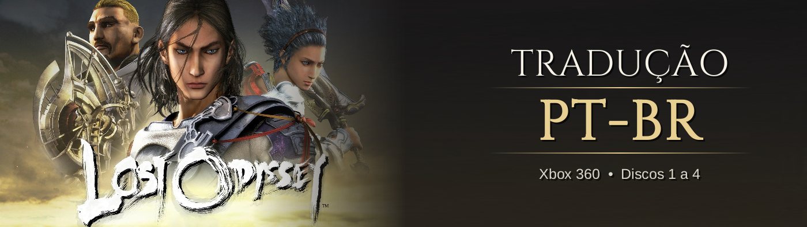
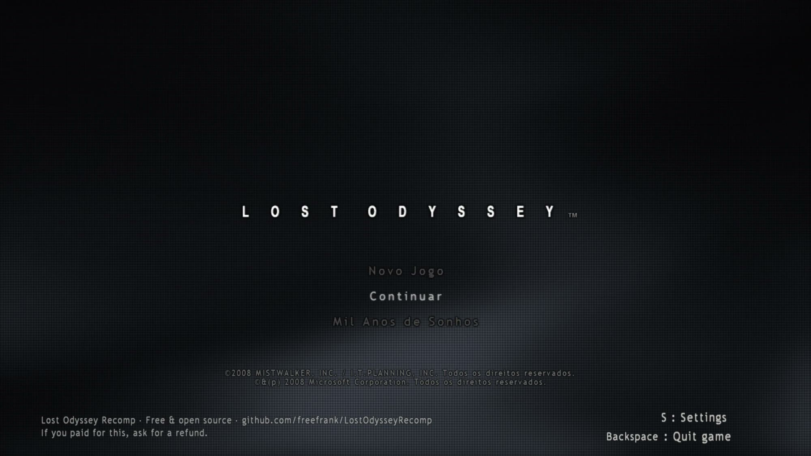
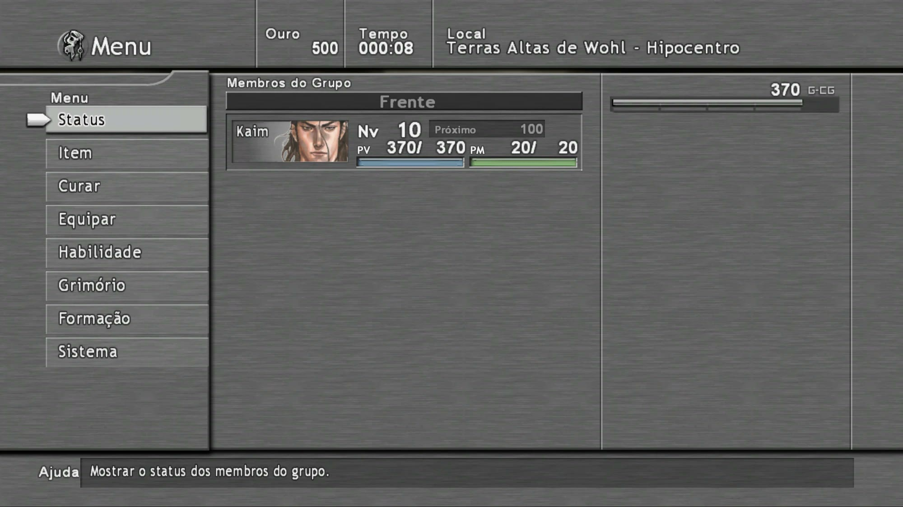
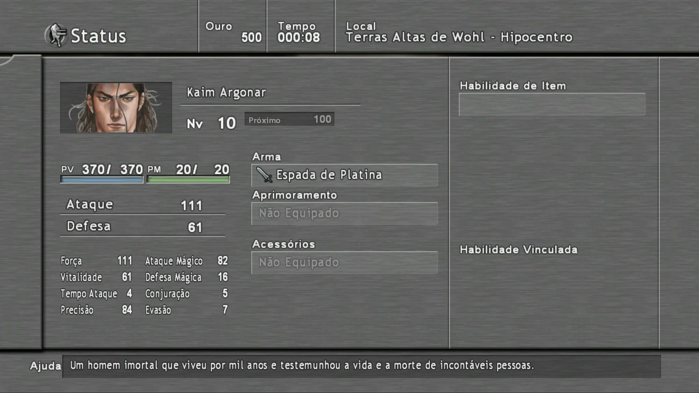
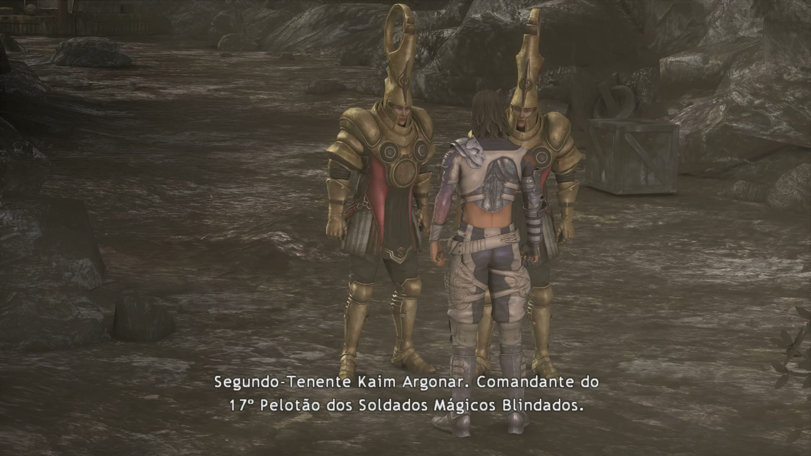
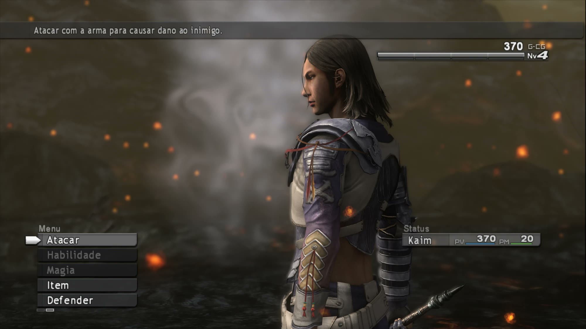
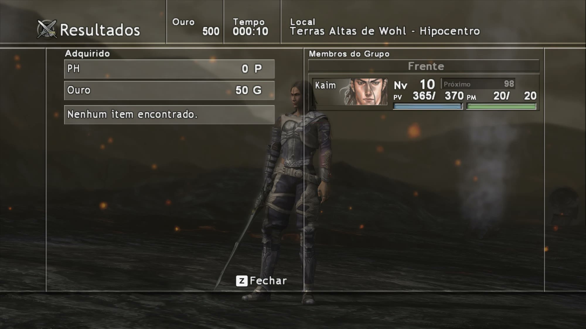

# ⚔️ Lost Odyssey (PC / Xbox 360) — Tradução PT-BR

-009c3b)

Tradução de fã do **Lost Odyssey** (Xbox 360, versão EUA/Europa), para jogar no PC pelo
[LostOdysseyRecomp](https://github.com/freefrank/LostOdysseyRecomp) ou com os discos do Xbox 360.
**Tradução completa para o português do Brasil**, com menus, história, diálogos, legendas, os contos de Mil Anos de
Sonhos, magias, itens, monstros, lugares e imagens com texto em português.

*Feita por fãs, para fãs. Gratuita, sem fins lucrativos e sem nenhuma ligação com a Microsoft ou a Mistwalker
(veja o aviso legal no fim desta página).*

> ✅ O jogo inteiro está traduzido. Se achar algum problema, abra uma [issue](../../issues).

## 📸 Fotos

| | |
|---|---|
|  |  |
| Tela de título | Menu (PV, PM e G-CG) |
|  |  |
| Status do personagem | Legendas das cenas |
|  |  |
| Batalha | Resultados da batalha |

## 📥 Download

**[⬇️ Baixar a tradução](../../releases/latest)** (página da versão mais recente). São dois zips, um para cada jeito de
jogar: `LostOdyssey_PTBR_Recomp` (PC, LostOdysseyRecomp) e `LostOdyssey_PTBR_Discos` (discos do Xbox 360, em ISO ou
extraídos). Cada um traz um guia `LEIA-ME.txt`. Como instalar: veja **💾 Instalação** abaixo.

## 🎮 O que foi traduzido

| Parte | Textos | Cobertura |
|---|---|---|
| Falas dos mapas (história, moradores, tutoriais, missões) | 26.666 | 100% |
| Mil Anos de Sonhos (36 contos) | 7.811 | 100% |
| Batalha (magias, habilidades, itens, monstros, descrições) | 5.192 | 100% |
| Legendas das cenas e dos vídeos | 3.459 | 100% |
| Menus | 2.001 | 100% |
| Nomes de mapas, andares, mapas do tesouro e lojas | 1.757 | 100% |
| Mensagens do sistema | 60 | 100% |
| Imagens com texto (painel e palavras da batalha, arena, anéis) | 4 texturas | 100% |

*As contagens incluem textos repetidos em vários lugares.*

- **Contexto da história:** cada fala foi traduzida sabendo em que ponto da aventura está, quem fala e com quem.
  Cada personagem tem o seu jeito de falar (o Jansen debochado e cheio de gíria, a Seth pirata e direta, a Ming
  formal...). Quando o inglês faz piada ou trocadilho, a piada foi refeita em português.
- **Mil Anos de Sonhos:** os contos aparecem em pedaços animados na tela. Cada conto foi traduzido inteiro, com o
  texto original ao lado, e os pedaços foram reencaixados para a frase em português se montar na ordem certa.
- **Cabe na tela:** os textos foram medidos com a fonte do próprio jogo.
- **Interface:** PV, PM e CG (Condição de Guarda) no lugar de HP, MP e GC; o dinheiro aparece com "o" de ouro (500o),
  como nas versões em espanhol, francês e italiano do jogo.
- **Imagens:** o painel de batalha (PV, PM, G-CG, I-CG), as palavras que aparecem na luta (ERROU, GUARDA, ATRASO...),
  a avaliação dos anéis (Perfeito, Bom, Ruim) e o resultado da arena (VITÓRIA!, FRACASSO...) foram redesenhados.

### Alguns exemplos

- **Magias:** *Flare/Flara/Flarus → Labareda/Labareda+/Labareda++ · Zephyr → Zéfiro*. Quem tem nível usa + e ++, como
  na versão em espanhol.
- **Monstros:** *Killalon → Matalolon · Diacorn → Diacórneo · Kelo-Numa/Kelo-Hiki → Kelo-Brejo/Kelo-Sapo* (no japonês,
  a segunda parte é o nome de uma rã).
- **General Kakanas → General Khatanos**, como nas versões em francês e italiano.
- **Lugares e navios:** *Highlands of Wohl → Terras Altas de Wohl · Grand Staff → Grande Cajado · Slantnose → Nariz
  Inclinado · White Boa → Jiboia Branca*.

## 🚫 O que não foi traduzido (de propósito)

| O quê | Por quê |
|---|---|
| Nomes próprios (Kaim, Seth, Jansen, Ming, Uhra, Numara, Gohtza…) | São nomes, iguais em todas as versões do jogo. O título que vem com eles se traduz ("King Tolten" = "Rei Tolten"). |
| Créditos finais (cargos e nomes da equipe) | Ficam como no original. |
| Fotos das telas de tutorial | São capturas da interface; o texto do tutorial ao lado está em português. |
| Logotipo, copyright e nomes dos botões do controle (START, BACK, LB, RB…) | Arte e marcas registradas. |
| Vozes | Fica a dublagem em inglês. |

## 💿 O que você precisa

Você precisa da sua **própria cópia** do **Lost Odyssey de Xbox 360, versão EUA/Europa** (4 discos). **Este projeto não
distribui o jogo.**

- **No PC:** o [LostOdysseyRecomp](https://github.com/freefrank/LostOdysseyRecomp) 1.1.0 ou mais novo, com os discos já
  importados.
- **Nos discos:** os discos em **ISO** ou já **extraídos em pastas** (cada uma com `default.xex`, `LO.fpi` e os arquivos
  `.fpd`). O programa extrai as ISOs sozinho. No Xbox 360, é preciso um console que rode jogos a partir de pastas
  (desbloqueado).

## 💾 Instalação

### 🖥️ No PC (LostOdysseyRecomp)

Feche o jogo antes.

1. Baixe o `LostOdyssey_PTBR_Recomp` na página de [Releases](../../releases/latest) e descompacte.
2. Copie as pastas `lo-ptbr` e `lo-ptbr-texturas` (de dentro de `mods` do zip) para a pasta **`mods`** do
   LostOdysseyRecomp (ao lado do `LostOdysseyRecomp.exe` no Windows). O caminho final fica `mods/lo-ptbr/language.ini`.
3. Abra o jogo, vá em **Settings** (Y na tela de título) e escolha o idioma do jogo **Português**. No Windows,
   `LostOdysseyRecomp.exe --setup` também abre essa escolha.
4. Reinicie o jogo se a tela pedir.

- **Para atualizar** a partir de qualquer versão anterior: apague de `mods` as pastas antigas da tradução (`lo-ptbr`,
  `lo-ptbr-texturas` e, se existir, `lo-ptbr-originais`) e copie as novas. Se o idioma estava em "Português (Nomes
  Originais)", escolha **Português** de novo. Os saves continuam funcionando.
- **Para desinstalar:** apague `lo-ptbr` e `lo-ptbr-texturas` de dentro de `mods`.

### 🎮 Nos discos (Xbox 360 ou emulador Xenia)

Feche o emulador antes.

1. Baixe o `LostOdyssey_PTBR_Discos` na página de [Releases](../../releases/latest) e descompacte.
2. Abra **`Aplicar Traducao (Windows).bat`** (no Linux ou Steam Deck: `./aplicar_traducao_linux.sh`, com o `xdelta3`
   instalado).
3. Diga onde está o jogo:
   - **1 - Em pastas:** escolha a pasta de um disco, a pasta que tem os 4 discos dentro ou a pasta `content` do Xenia
     (para as DLCs).
   - **2 - Em ISO:** escolha as ISOs (pode marcar as 4). Cada uma é extraída para uma pasta com o mesmo nome, ao lado da
     ISO (cerca de 5,4 GB por disco), e a tradução vai nessa pasta. A ISO não é alterada.
4. Escolha **1 - Instalar a tradução**. O programa reconhece cada disco e cada DLC sozinho.
5. Rode o jogo pela pasta (no Xenia, abra o `default.xex`). Deixe o idioma do console ou do emulador em **inglês** (no
   Xenia: `user_language = 1`).

**DLCs (só no Xenia):** a *Triple Bonus Pack* e a *Dungeon Pack: Seeker of the Deep!* têm texto; a *Double Bonus Pack*
não tem. Instale as DLCs no Xenia (**File → Install Content**) e rode o programa escolhendo a pasta `content` do Xenia.
No Xbox 360 de verdade as DLCs ficam em inglês, porque os pacotes de DLC do console são assinados e não podem ser
alterados.

Nos discos, as imagens com texto (painel e palavras da batalha, arena, anéis) ficam em inglês: as imagens traduzidas só
existem no pacote do PC.

- **Para atualizar** a partir de qualquer versão anterior (inclusive a antiga "Nomes Originais"): rode o programa novo e
  escolha **1**. Ele reconhece a versão anterior e atualiza a partir do backup dos originais.
- **Para desinstalar:** rode o programa e escolha **2** (volta os arquivos originais).

## 🔒 Segurança

- Baixe a tradução **só pela página de [Releases](../../releases) deste repositório**.
- Faça backup dos seus saves antes de jogar.
- Nos discos, o programa guarda os arquivos originais em `_backup_original_ptbr` (cerca de 330 MB por disco e 90 MB pelas
  duas DLCs) antes de mexer e, no fim, confere se o resultado está certo. Ele usa o `xdelta3` oficial (licença GPL) e o
  `extract-xiso`, que vêm na pasta `ferramentas`.

## ❓ Não funcionou?

| Sintoma | Causa provável |
|---|---|
| (PC) O idioma "Português" não aparece | A pasta foi copiada para o lugar errado (tem que ficar `mods/lo-ptbr/language.ini`, não `mods/mods/lo-ptbr`) ou o LostOdysseyRecomp é antigo. |
| (PC) Imagens da batalha em inglês | Faltou copiar `lo-ptbr-texturas`. |
| (Discos) "Nenhum disco encontrado" | A pasta escolhida não tem o jogo extraído (use a opção 2 para ISO) ou não é a versão EUA/Europa. |
| (Discos) "Ignorado (versão desconhecida ou modificada)" | Os arquivos do disco foram alterados por outro mod ou são de outra versão do jogo. |
| (Discos) Imagens da batalha em inglês | Normal nos discos: as imagens traduzidas só existem no pacote do PC. |
| Textos misturados depois de atualizar | Você carregou um *save state* feito com a versão anterior. Feche o jogo e continue pelo save normal. |
| Travamento | Abra uma issue informando onde aconteceu. |

## 🐞 Achou um erro?

Abra uma [issue](../../issues/new/choose) usando o formulário "Erro na tradução". Informe a versão da tradução, onde você
joga (PC ou discos), o lugar do jogo e, se puder, mande um print. Toda correção de português também é bem-vinda.

## 🙏 Créditos

- **Tradução, revisão, imagens e ferramentas:** [0xdhx0](https://github.com/0xdhx0).
- **[LostOdysseyRecomp](https://github.com/freefrank/LostOdysseyRecomp)**, que torna possível traduzir o jogo com
  pacotes de idioma e texturas.
- **[xdelta](https://github.com/jmacd/xdelta-gpl)** e **[extract-xiso](https://github.com/XboxDev/extract-xiso)**, usados
  para aplicar a tradução nos discos.
- **Fonte livre** usada nas imagens: Liberation Sans (licença OFL).

**Como foi feita:** a tradução usou ferramentas de IA. Todos os textos foram revisados com o contexto da história e o
jeito de falar de cada personagem, medidos para caber na tela e testados no jogo. Se achar uma frase estranha, abra uma
[issue](../../issues), porque toda sugestão ajuda.

## ⚖️ Aviso legal e uso

- Esta é uma **tradução feita por fãs, para fãs**, **gratuita** e **sem fins lucrativos**.
- **Não temos nenhuma ligação** com a Microsoft, a Mistwalker, a feelplus ou qualquer outra empresa envolvida no jogo.
  O projeto não é oficial, nem aprovado ou apoiado por elas.
- *Lost Odyssey* e todos os nomes, marcas e personagens pertencem aos seus donos (© Microsoft Corporation /
  MISTWALKER / I.T.PLANNING).
- A tradução contém **apenas os textos em português, as imagens redesenhadas e patches de diferença** e **não
  funciona sem uma cópia do jogo**. Nenhum arquivo do jogo é distribuído aqui: não peça nem compartilhe o jogo neste
  repositório.
- Pode usar e compartilhar a tradução à vontade, **de graça**. Ela **não pode ser vendida** nem monetizada. Se alguém
  cobrou por ela, você foi enganado. Veja [LICENSE.txt](LICENSE.txt).
- Se você é detentor de algum direito e quer que algo seja retirado, abra uma issue ou entre em contato pelo GitHub.

Apoie a franquia comprando os jogos oficiais.
