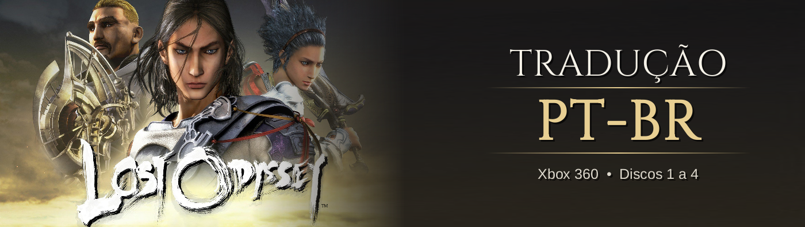
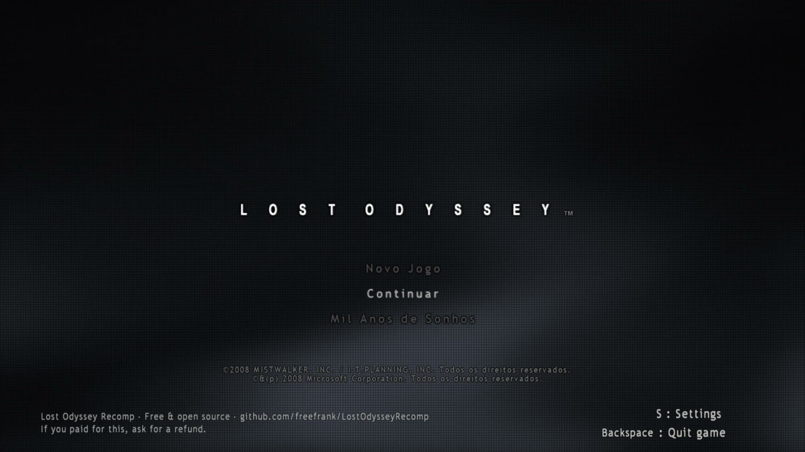
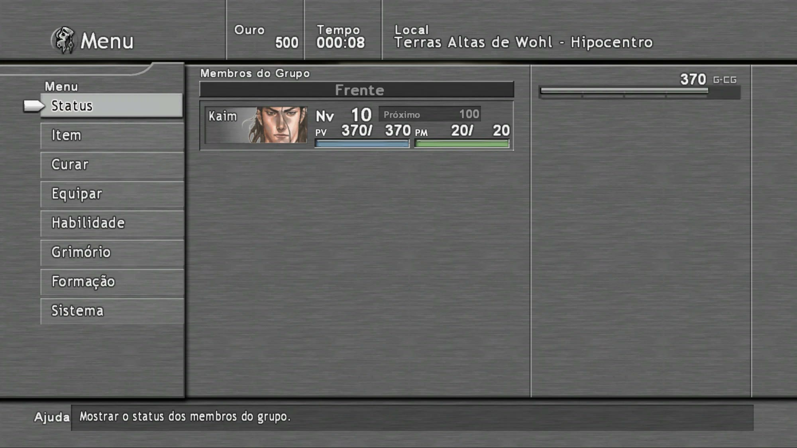
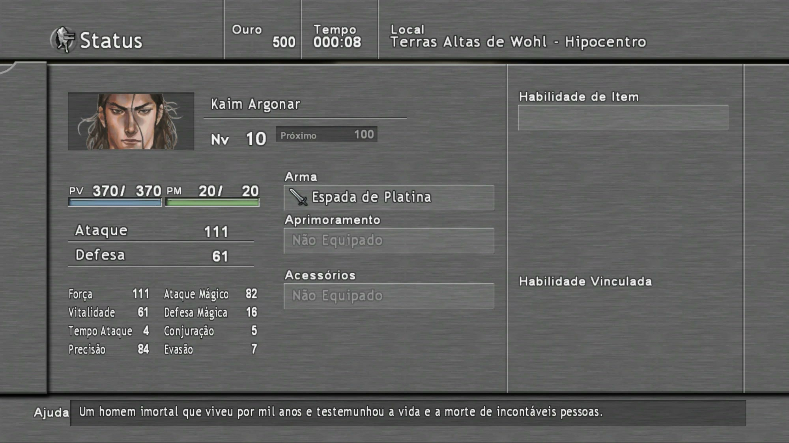
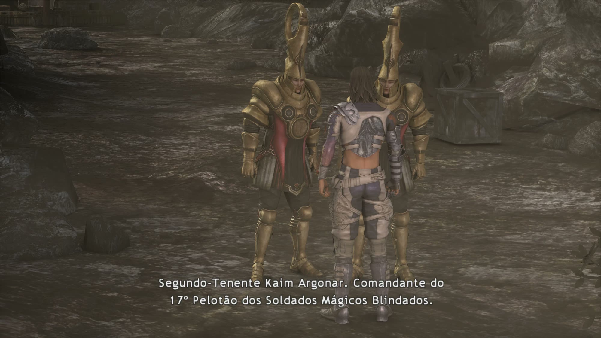
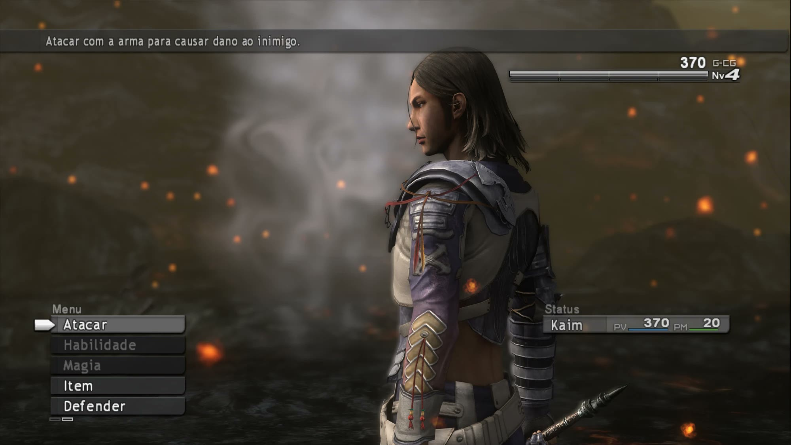
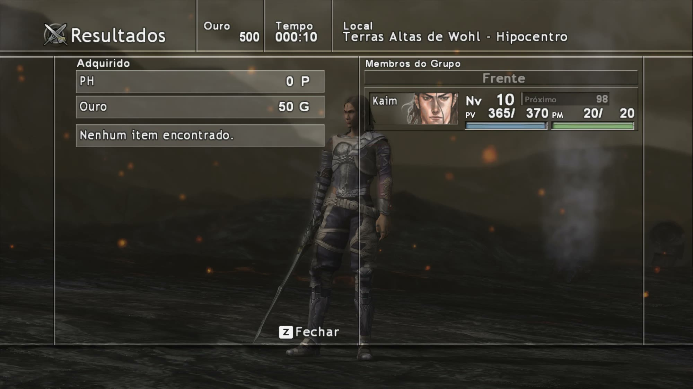

# ⚔️ Lost Odyssey — Tradução PT-BR v1.0

-009c3b)

Tradução de fã do **Lost Odyssey** (Xbox 360, versão EUA/Europa) para o **português do Brasil**. Funciona de dois
jeitos, cada um com o seu download:

| Onde você joga | Pacote | O que tem |
|---|---|---|
| 🖥️ **[LostOdysseyRecomp](https://github.com/freefrank/LostOdysseyRecomp)** (recompilação para PC) | `LostOdyssey_PTBR_Recomp_v1.0.zip` | Pacotes de idioma e imagens do recomp: a experiência mais completa, com as imagens com texto também em português |
| 🎮 **Emulador [Xenia](https://xenia.jp)** ou **Xbox 360** | `LostOdyssey_PTBR_Discos_v1.0.zip` | Patch para os 4 discos (em ISO ou extraídos) e para as DLCs no Xenia, com um programa que aplica a tradução sozinho |

> 🖥️ A tradução foi feita para o [LostOdysseyRecomp](https://github.com/freefrank/LostOdysseyRecomp), e o patch dos
> discos é gerado a partir dela: os textos são os mesmos nos dois pacotes. Nos discos, só as imagens com texto ficam em
> inglês.

*Feita por fãs, para fãs. Gratuita, sem fins lucrativos e sem nenhuma ligação com a Microsoft ou a Mistwalker
(veja o aviso legal no fim desta página).*

> ✅ História, moradores, legendas das cenas, os 36 contos de **Mil Anos de Sonhos**, menus, itens, magias,
> habilidades, monstros, mapas do tesouro, créditos e as imagens com texto estão em português. Se achar algum
> problema, abra uma [issue](../../issues).

## 📸 Fotos

| | |
|---|---|
|  |  |
| Tela de título | Menu (PV, PM e G-CG) |
|  |  |
| Status do personagem | Legendas das cenas |
|  |  |
| Batalha | Resultados da batalha |

*Fotos da versão Nomes Traduzidos.*

## 📥 Download (v1.0)

**[⬇️ Baixar na página de Releases](../../releases/latest)**. Os dois zips trazem as **duas versões** da tradução e um
guia `LEIA-ME.txt`.

**`LostOdyssey_PTBR_Recomp_v1.0.zip`** (LostOdysseyRecomp):

| Dentro do zip | O que é |
|---|---|
| `mods/lo-ptbr/` | Versão **Nomes Traduzidos** (pacote de idioma "Português") |
| `mods/lo-ptbr-originais/` | Versão **Nomes Originais** (pacote de idioma "Português (Nomes Originais)") |
| `mods/lo-ptbr-texturas/` | Imagens com texto em português (só para a Nomes Traduzidos) |
| `LEIA-ME.txt`, `LICENSE.txt` | Guia de instalação e termos de uso |

**`LostOdyssey_PTBR_Discos_v1.0.zip`** (Xenia e Xbox 360):

| Dentro do zip | O que é |
|---|---|
| `Aplicar Traducao (Windows).bat` | Aplica a tradução nos discos (ISO ou pasta) e nas DLCs: escolha os arquivos e a versão |
| `aplicar_traducao_linux.sh` | O mesmo para Linux e Steam Deck (precisa do `xdelta3` instalado) |
| `patches/` | Patches xdelta dos 4 discos e das DLCs, nas duas versões |
| `ferramentas/` | Script do instalador, o `xdelta3` oficial (licença GPL) e o `extract-xiso` (para as ISOs) |
| `LEIA-ME.txt`, `LICENSE.txt` | Guia de instalação e termos de uso |

## 🎭 Duas versões: escolha a sua

| | **Nomes Traduzidos** | **Nomes Originais** |
|---|---|---|
| Menus, história, diálogos, legendas e descrições | Português | Português |
| Mil Anos de Sonhos | Português | Português |
| Magias | Português (*Labareda, Labareda+*) | Originais (*Flare, Flara*) |
| Habilidades e golpes | Português | Originais |
| Itens, equipamentos e anéis | Português (*Anel Brutamontes+*) | Originais |
| Monstros | Português | Originais |
| Cidades e mapas onde se passa | Português (*Terras Altas de Wohl, Caverna Negra*) | Originais (*Highlands of Wohl, Black Cave*) |
| Lojas, pousadas, navios e reinos | Português (*Jiboia Branca, Nariz Inclinado*) | Português (iguais) |
| Organizações, termos do mundo e títulos com nome | Português (*Conselho de Uhra, Rei Tolten*) | Português (iguais) |
| Nomes próprios (Kaim, Seth, Ming, Jansen, Gongora…) | Iguais | Iguais |
| Siglas | PV, PM, CG, Nv | PV, PM, CG, Nv |
| Imagens com texto (painel e palavras da batalha, arena, anéis) | Traduzidas (só no recomp) | Originais (inglês) |

- **Nomes Traduzidos:** o jogo todo em português. Só os nomes próprios ficam como no original; o título que vem com
  eles se traduz ("King Tolten" = "Rei Tolten").
- **Nomes Originais:** para quem joga com guia, wiki ou fórum em inglês. É igual à Nomes Traduzidos, menos o que se
  procura num guia: **cidades e mapas, itens, equipamentos, habilidades, magias e monstros** ficam como no original.
  Todo o resto continua em português, e a frase em volta também ("Kaim aprende Flare", "vamos para Highlands of Wohl").

As duas usam os mesmos saves: dá para trocar de versão a qualquer momento.

## 🎮 O que foi traduzido

| Parte | Textos |
|---|---|
| Falas dos mapas (história, moradores, tutoriais, missões) | 26.666 |
| Mil Anos de Sonhos (36 contos) | 7.811 |
| Batalha (magias, habilidades, itens, monstros, descrições) | 5.175 |
| Legendas das cenas e dos vídeos | 3.459 |
| Menus | 2.001 |
| Nomes de mapas, andares, mapas do tesouro e lojas | 1.757 |
| Créditos e mensagens do sistema | 855 |
| Imagens com texto | 4 texturas |

*As contagens incluem textos repetidos em vários lugares.*

- **Contexto da história:** cada fala foi traduzida sabendo em que ponto da aventura está, quem fala e com quem.
  Cada personagem tem o seu jeito de falar (o Jansen debochado e cheio de gíria, a Seth pirata e direta, a Ming
  formal...). Quando o inglês faz piada ou trocadilho, a piada foi refeita em português.
- **Mil Anos de Sonhos:** os contos aparecem em pedaços animados na tela. Cada conto foi traduzido inteiro, com o
  texto original ao lado, e os pedaços foram reencaixados para a frase em português se montar na ordem certa.
- **Cabe na tela:** os textos foram medidos com a fonte do próprio jogo.
- **Imagens:** o painel de batalha (PV, PM, G-CG, I-CG), as palavras que aparecem na luta (ERROU, GUARDA, ATRASO...),
  a avaliação dos anéis (Perfeito, Bom, Ruim) e o resultado da arena (VITÓRIA!, FRACASSO...) foram redesenhados.

**Fica como no original:** as vozes (o pacote usa a dublagem em inglês), as fotos dos tutoriais (o texto do tutorial
ao lado está em português), os nomes da equipe nos créditos e os títulos das músicas.

## 🧩 Requisitos

- O **Lost Odyssey de Xbox 360, versão EUA/Europa** (4 discos).
- **No PC pelo recomp:** o [LostOdysseyRecomp](https://github.com/freefrank/LostOdysseyRecomp) 1.1.0 ou mais novo, com
  os discos já importados.
- **No Xenia ou no Xbox 360:** os discos em **ISO** ou já **extraídos em pastas** (cada uma com `default.xex`, `LO.fpi`
  e os arquivos `.fpd`). O programa extrai as ISOs sozinho. No Xbox 360, é preciso um console que rode jogos a partir de
  pastas (desbloqueado).

## 💾 Instalação no LostOdysseyRecomp

Feche o jogo antes.

1. Baixe o `LostOdyssey_PTBR_Recomp_v1.0.zip` na página de [Releases](../../releases) e descompacte.
2. Copie o conteúdo da pasta `mods` do zip para a pasta **`mods`** do LostOdysseyRecomp (ao lado do
   `LostOdysseyRecomp.exe` no Windows).
   - Quer a **Nomes Traduzidos**? Copie `lo-ptbr` e `lo-ptbr-texturas`.
   - Quer a **Nomes Originais**? Copie `lo-ptbr-originais` (sem a pasta de texturas, para as imagens ficarem em inglês).
   - Pode copiar os dois pacotes de idioma: aí você escolhe qual usar nas configurações.
3. Abra o jogo, vá em **Settings** (Y na tela de título) e escolha o idioma do jogo **Português** (ou
   **Português (Nomes Originais)**). No Windows, `LostOdysseyRecomp.exe --setup` também abre essa escolha.
4. Reinicie o jogo se a tela pedir.

**Para desinstalar:** apague as pastas `lo-ptbr`, `lo-ptbr-originais` e `lo-ptbr-texturas` de dentro de `mods`.

## 💾 Instalação nos discos (Xenia e Xbox 360)

Feche o emulador antes.

1. Baixe o `LostOdyssey_PTBR_Discos_v1.0.zip` na página de [Releases](../../releases) e descompacte.
2. Abra **`Aplicar Traducao (Windows).bat`** (no Linux ou Steam Deck: `./aplicar_traducao_linux.sh`).
3. Diga onde está o jogo:
   - **1 - Em pastas:** escolha a pasta de um disco, a pasta que tem os 4 discos dentro ou a pasta `content` do Xenia
     (para as DLCs).
   - **2 - Em ISO:** escolha as ISOs (pode marcar as 4). Cada uma é extraída para uma pasta com o mesmo nome, ao lado da
     ISO (cerca de 5,4 GB por disco), e a tradução vai nessa pasta. A ISO não é alterada.
4. Escolha a versão: **1** = Nomes Traduzidos, **2** = Nomes Originais. O programa reconhece cada disco e cada DLC
   sozinho.
5. Abra o `default.xex` da pasta no Xenia (ou rode o jogo no Xbox 360). Deixe o idioma do console ou do emulador em
   **inglês** (no Xenia: `user_language = 1`).

**DLCs (só no Xenia):** a *Triple Bonus Pack* e a *Dungeon Pack: Seeker of the Deep!* têm texto; a *Double Bonus Pack*
não tem. Instale as DLCs no Xenia (**File → Install Content**) e rode o programa na opção 1, escolhendo a pasta `content`
do Xenia. No Xbox 360 de verdade as DLCs ficam em inglês, porque os pacotes de DLC do console são assinados e não
podem ser alterados.

Antes de mexer, o programa guarda os arquivos originais em `_backup_original_ptbr` (cerca de 330 MB por disco e 90 MB
pelas duas DLCs) e, no fim, confere se o resultado está certo. Para trocar de versão é só rodar de novo.

**Para desinstalar:** rode o programa de novo e escolha **3** (volta os arquivos originais).

## ❓ Não funcionou?

| Sintoma | Causa provável |
|---|---|
| O idioma "Português" não aparece | A pasta foi copiada para o lugar errado (tem que ficar `mods/lo-ptbr/language.ini`) ou o recomp é antigo. |
| Textos em inglês nas imagens da batalha | Faltou copiar `lo-ptbr-texturas` (ou você está na Nomes Originais, que mantém as imagens em inglês). |
| Imagens em português na Nomes Originais | Apague `lo-ptbr-texturas` da pasta `mods`. |
| (Discos) "Nenhum disco encontrado" | A pasta escolhida não tem o jogo extraído (use a opção 2 para ISO) ou não é a versão EUA/Europa. |
| (Discos) "Ignorado (versão desconhecida ou modificada)" | Os arquivos do disco foram alterados por outro mod ou são de outra versão do jogo. |
| (Discos) Textos em inglês nas imagens da batalha | Normal nos discos: as imagens traduzidas só existem no pacote do recomp. |

## 🐞 Achou um erro?

Abra uma [issue](../../issues/new/choose) usando o formulário "Erro na tradução". Informe a versão (Nomes Traduzidos ou
Nomes Originais), o lugar do jogo e, se puder, mande um print. Toda correção de português também é bem-vinda.

## 🙏 Créditos

- **Tradução, revisão, imagens e ferramentas:** [0xdhx0](https://github.com/0xdhx0).
- **[LostOdysseyRecomp](https://github.com/freefrank/LostOdysseyRecomp)**, que torna possível traduzir o jogo com
  pacotes de idioma e texturas.
- **[xdelta](https://github.com/jmacd/xdelta-gpl)** e **[extract-xiso](https://github.com/XboxDev/extract-xiso)**, usados
  para aplicar a tradução nos discos.
- **Fonte livre** usada nas imagens: Liberation Sans (licença OFL).

**Como foi feita:** a tradução usou ferramentas de IA. Todos os textos foram revisados com o contexto da história e o
jeito de falar de cada personagem, medidos para caber na tela e testados no jogo. Se achar uma frase estranha, abra uma
[issue](../../issues), porque toda sugestão ajuda.

## ⚖️ Aviso legal e uso

- Esta é uma **tradução feita por fãs, para fãs**, **gratuita** e **sem fins lucrativos**.
- **Não temos nenhuma ligação** com a Microsoft, a Mistwalker, a feelplus ou qualquer outra empresa envolvida no jogo.
  O projeto não é oficial, nem aprovado ou apoiado por elas.
- *Lost Odyssey* e todos os nomes, marcas e personagens pertencem aos seus donos (© Microsoft Corporation /
  MISTWALKER / I.T.PLANNING).
- A tradução contém **apenas os textos em português, as imagens redesenhadas e patches de diferença** e **não
  funciona sem uma cópia do jogo**. Nenhum arquivo do jogo é distribuído aqui. Não peça nem compartilhe o jogo neste repositório.
- Pode usar e compartilhar a tradução à vontade, **de graça**. Ela **não pode ser vendida** nem monetizada. Se alguém
  cobrou por ela, você foi enganado. Veja [LICENSE.txt](LICENSE.txt).
- Se você é detentor de algum direito e quer que algo seja retirado, abra uma issue ou entre em contato pelo GitHub.

Apoie a franquia comprando os jogos oficiais.
